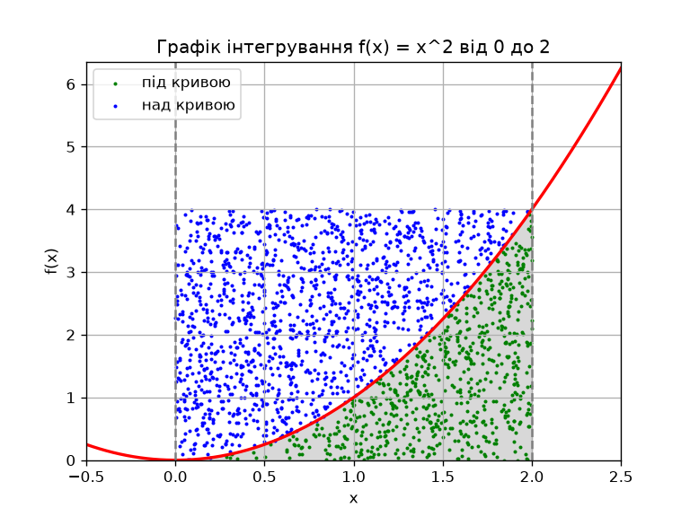

# goit-algo-hw-10

Домашнє завдання до тем 9–10 «Жадібні алгоритми та динамічне програмування», «Лінійне програмування та рандомізовані алгоритми».

## Структура

| Файл | Опис |
|---|---|
| `task1.py` | Завдання 1 — видача решти: `find_coins_greedy` (жадібний) і `find_min_coins` (динамічне програмування), порівняння часу виконання |
| `task2.py` | Завдання 2 — інтеграл `f(x) = x²` на `[0, 2]` методом Монте-Карло, порівняння з `scipy.integrate.quad` та аналітичним розв'язком |
| `monte_carlo.png` | Графік функції з випадковими точками методу Монте-Карло |
| `requirements.txt` | Залежності |

## Запуск

```bash
python3 -m venv .venv
.venv/bin/pip install -r requirements.txt
.venv/bin/python task1.py
.venv/bin/python task2.py
```

## Завдання 1. Видача решти

Набір монет: `[50, 25, 10, 5, 2, 1]`.

```text
Сума: 113
  find_coins_greedy: {50: 2, 10: 1, 2: 1, 1: 1}
  find_min_coins:    {1: 1, 2: 1, 10: 1, 50: 2}
```

- **`find_coins_greedy`** перебирає номінали від найбільшого до найменшого й бере кожного стільки, скільки вміщується в залишок (`divmod`).
  Складність — **O(k)**, де k — кількість номіналів; від суми час практично не залежить.
- **`find_min_coins`** заповнює таблицю `min_coins[s]` — мінімальну кількість монет для кожної суми від 0 до n — і запам'ятовує останню використану монету, щоб відновити набір.
  Складність — **O(n · k)** за часом і **O(n)** за пам'яттю, де n — сума.

### Порівняння часу виконання

| Сума | Жадібний, с | ДП, с | ДП повільніший у | Монет (жадібний / ДП) |
|---:|---:|---:|---:|---:|
| 10 | 6.0e-07 | 3.3e-06 | 6× | 1 / 1 |
| 113 | 6.5e-07 | 4.1e-05 | 62× | 5 / 5 |
| 1 000 | 5.7e-07 | 4.1e-04 | 717× | 20 / 20 |
| 10 000 | 6.7e-07 | 4.2e-03 | 6 251× | 200 / 200 |
| 100 000 | 7.1e-07 | 4.5e-02 | 63 919× | 2 000 / 2 000 |
| 1 000 000 | 7.9e-07 | 4.8e-01 | 611 411× | 20 000 / 20 000 |

(Час залежить від машини; важливий порядок величин.)

### Висновки

1. **На великих сумах ефективніший жадібний алгоритм.** Його час сталий (~0.7 мкс) для будь-якої суми, бо він робить одну операцію на номінал. Час ДП зростає лінійно із сумою: зі збільшенням суми в 10 разів він зростає приблизно в 10 разів, і для суми 1 000 000 займає ~0.5 с та потребує масиву на мільйон елементів. Для дуже великих сум ДП стає непрактичним через час і пам'ять.
2. **Для цього набору монет обидва алгоритми дають однаковий (оптимальний) результат.** Набір `[50, 25, 10, 5, 2, 1]` — канонічний: для нього жадібний вибір завжди дає мінімальну кількість монет. Це видно в останньому стовпці таблиці. Тому для касового апарата з таким набором жадібний алгоритм — найкращий вибір.
3. **ДП потрібне, коли набір монет неканонічний.** Для монет `[1, 3, 4]` і суми 6 жадібний алгоритм видає `{4: 1, 1: 2}` (3 монети), а ДП — `{3: 2}` (2 монети). ДП гарантує оптимум для будь-якого набору номіналів, а жадібний — лише для канонічних.

Підсумок: жадібний алгоритм — для стандартних наборів монет і великих сум, ДП — коли номінали довільні й важлива гарантія мінімальної кількості монет, а сума помірна.

## Завдання 2. Інтеграл методом Монте-Карло

Функція `f(x) = x²`, межі `a = 0`, `b = 2`.

**Метод (метод «влучань»).** Генеруємо N випадкових точок, рівномірно розподілених у прямокутнику `[0, 2] × [0, 4]` (4 = max f на відрізку). Частка точок, що лежать під кривою, приблизно дорівнює частці площі прямокутника під графіком:

```
I ≈ (b − a) · y_max · (кількість точок під кривою / N)
```



### Перевірка

- Аналітично: ∫₀² x² dx = x³/3 |₀² = 8/3 ≈ **2.666667**
- `scipy.integrate.quad`: **2.666667**, оцінка похибки 3.0e-14

| Кількість точок N | Монте-Карло | Абс. похибка | Відн. похибка |
|---:|---:|---:|---:|
| 100 | 2.720000 | 0.053333 | 2.000% |
| 1 000 | 2.656000 | 0.010667 | 0.400% |
| 10 000 | 2.636000 | 0.030667 | 1.150% |
| 100 000 | 2.678160 | 0.011493 | 0.431% |
| 1 000 000 | 2.664552 | 0.002115 | 0.079% |
| 10 000 000 | 2.664572 | 0.002095 | 0.079% |

(`numpy.random.default_rng(42)`, тож результати відтворювані.)

### Висновки

1. **Розрахунки правильні.** Значення методом Монте-Карло збігаються з аналітичним результатом і результатом `quad` (8/3 ≈ 2.666667): уже при 1 000 000 точок відносна похибка менша за 0.1%.
2. **Точність зростає зі збільшенням кількості точок, але повільно.** Похибка методу спадає приблизно як 1/√N: щоб зменшити її в 10 разів, треба в 100 разів більше точок. Оскільки метод випадковий, похибка зменшується не монотонно (наприклад, при N = 10 000 вона випадково більша, ніж при N = 1 000), але загальна тенденція чітка.
3. **`quad` для одновимірного гладкого інтеграла кращий:** він дає точність ~1e-14 за частки мілісекунди. Метод Монте-Карло корисний там, де класичні методи погано працюють: багатовимірні інтеграли (похибка 1/√N не залежить від розмірності), складні області інтегрування або функції, які важко проінтегрувати аналітично. Для таких задач він дає наближений результат із контрольованою точністю.
